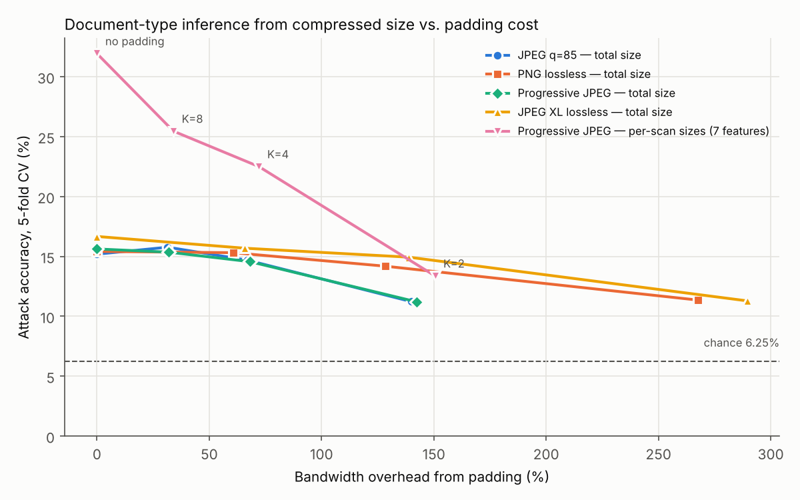
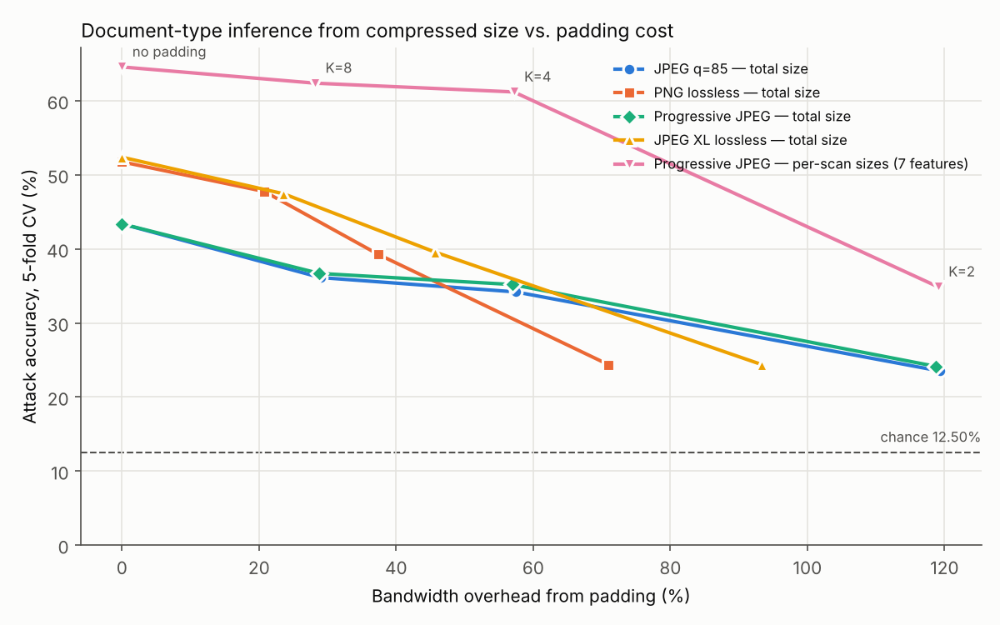
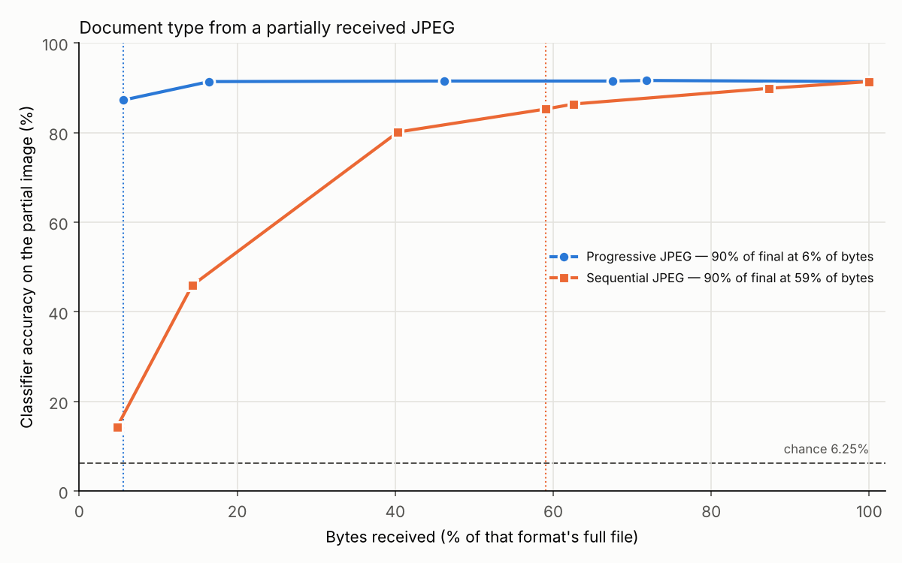

# Document-type leakage from compressed image size

Three feasibility experiments on public data:

1. **Exp 1:** can a network observer who sees only the byte size of an image
   sent over TLS tell what *kind* of document it shows? Uses 16 RVL-CDIP classes.
2. **Exp 2:** the same attack on a more realistic mix: identity documents
   (ID card, passport, driving licence) plus five RVL-CDIP classes.
3. **Exp 3:** how much of a JPEG must arrive before a pretrained classifier
   knows the document type, for progressive vs sequential JPEG?

| | Setting | Chance | Best total-size attack | Per-scan attack | Padding, K=8 (per-scan) |
|---|---|---:|---:|---:|---:|
| Exp 1 | 16 RVL-CDIP classes | 6.25% | 16.7% (JPEG XL) | 31.9% | 25.5% at +34% bytes |
| Exp 2 | 3 ID classes + 5 RVL-CDIP classes | 12.5% | 52.4% (JPEG XL) | 64.6% | 62.4% at +28% bytes |
| Exp 2 | ID card vs passport only | 50% | 95.5% (JPEG XL) | 100% | — |

| Exp 3 (DiT on 800 RVL-CDIP test images) | Full-file accuracy | Bytes needed for 90% of it |
|---|---:|---:|
| Progressive JPEG | 91.4% | **5.6%** (first scan alone: 87.2%) |
| Sequential JPEG | 91.4% | 59.0% (≈48% interpolated) |

**Bottom line.**
* Across 16 visually similar office documents, total size leaks a little
  (about 2.5× chance).
* Identity documents stand out sharply from office documents, and from each
  other. For ID card vs passport, see the caveats in Exp 2: each class is
  only five fixed designs.
* Progressive-JPEG scan sizes roughly double the leak.
* Bucket padding up to K=8 removes little of it and costs 20–66% extra bandwidth.
* A progressive JPEG gives away the document type in its first ~6% of bytes.

---

## Exp 1: 16 RVL-CDIP classes (300 images × 16 = 4,800)



Random Forest (200 trees; `min_samples_leaf` ∈ {1, 5, 20, 50} picked by an
inner 3-fold CV), stratified 5-fold CV, mean ± sd over the outer folds.
Chance = 6.25%.

| Observed features | Padding K | Bandwidth overhead | Accuracy | Macro-F1 |
|---|---:|---:|---:|---:|
| JPEG q=85 — total size | none | 0.0% | 15.2 ± 0.4% | 12.8 ± 0.4% |
| JPEG q=85 — total size | 8 | 31.5% | 15.8 ± 0.5% | 8.8 ± 0.9% |
| JPEG q=85 — total size | 4 | 67.0% | 14.7 ± 0.5% | 5.9 ± 0.2% |
| JPEG q=85 — total size | 2 | 139.9% | 11.2 ± 0.2% | 2.5 ± 0.1% |
| PNG lossless — total size | none | 0.0% | 15.4 ± 1.4% | 13.6 ± 1.2% |
| PNG lossless — total size | 8 | 60.6% | 15.3 ± 0.4% | 8.7 ± 0.4% |
| PNG lossless — total size | 4 | 128.3% | 14.2 ± 0.6% | 5.7 ± 0.3% |
| PNG lossless — total size | 2 | 267.7% | 11.4 ± 0.2% | 2.5 ± 0.0% |
| Progressive JPEG — total size | none | 0.0% | 15.6 ± 1.3% | 13.3 ± 1.0% |
| Progressive JPEG — total size | 8 | 32.0% | 15.4 ± 0.4% | 8.4 ± 0.6% |
| Progressive JPEG — total size | 4 | 68.1% | 14.6 ± 0.5% | 5.8 ± 0.2% |
| Progressive JPEG — total size | 2 | 142.4% | 11.2 ± 0.2% | 2.5 ± 0.0% |
| JPEG XL lossless — total size | none | 0.0% | 16.7 ± 1.6% | 14.2 ± 1.6% |
| JPEG XL lossless — total size | 8 | 65.7% | 15.7 ± 0.4% | 8.8 ± 0.3% |
| JPEG XL lossless — total size | 4 | 138.9% | 14.9 ± 0.6% | 6.0 ± 0.2% |
| JPEG XL lossless — total size | 2 | 289.5% | 11.3 ± 0.2% | 2.5 ± 0.0% |
| **Progressive JPEG — per-scan sizes (7 features)** | none | 0.0% | **31.9 ± 1.1%** | **30.7 ± 1.0%** |
| Progressive JPEG — per-scan sizes | 8 | 34.0% | 25.5 ± 1.3% | 23.9 ± 1.2% |
| Progressive JPEG — per-scan sizes | 4 | 72.1% | 22.5 ± 1.5% | 19.9 ± 1.2% |
| Progressive JPEG — per-scan sizes | 2 | 150.5% | 13.4 ± 0.4% | 6.3 ± 0.4% |
| Control: image width & height (not on the wire) | none | — | 14.2 ± 0.8% | 9.8 ± 1.0% |

Files: `results/results.csv`, `results/per_class_f1.csv`, and
`results/sizes.csv` (per-image sizes).

### What the numbers say

* **All four encoders leak about the same amount** through total size: 15–17%.
  Lossless JPEG XL is slightly ahead, and is also the most expensive to pad.
* **Progressive scan boundaries double the leak.** The 7 numbers are the
  header plus 6 scans. They split the image's energy into DC, low-frequency
  AC and high-frequency AC. That separates text-dense pages from photo and
  graphics pages much better than one total does.
* **The leak is page content, not page geometry.** Image dimensions are
  class-correlated in RVL-CDIP: the width/height control alone gets 14%.
  But size divided by pixel count (bytes/pixel) gives the same accuracy as
  raw size: 15.5% for JPEG and 16.9% for JPEG XL. Combining size with W,H
  gives 23–24%, so the two signals are complementary.
  Reproduce with `python check_dimensions.py results/sizes.csv`.
* **Padding barely moves *accuracy* for total size, but it does cut macro-F1.**
  With K buckets the best attacker can do is guess the most common class in
  each bucket. That keeps accuracy near the unpadded level but collapses
  per-class recall. Read macro-F1 for the defense rows. At K=2, accuracy is
  11% while macro-F1 is 2.5%: the attacker only ever guesses two classes.
* **Padding is costly.** Buckets are equal-frequency quantiles, with the top
  edge at the largest image, so a heavy tail makes the top bucket expensive.
  Padding *everything* to the maximum (K=1, which is guaranteed chance) costs
  290% (JPEG), 295% (progressive JPEG), 553% (PNG) and 597% (JPEG XL).
* **The per-scan attack needs per-scan padding.** If you pad only the total,
  the scan boundaries still leak everything in the first per-scan row. The
  defense rows above pad *each* scan independently.

---

## Exp 2: identity documents + office documents (200 images × 8 = 1,600)

| Class | Source | Notes |
|---|---|---|
| `id_card` | MIDV-2020 templates: Albania, Spain, Estonia, Finland, Slovakia (40 each) | flat colour renders, synthetic personal data |
| `passport` | MIDV-2020 templates: Azerbaijan, Greece, Latvia, Serbia, Russia internal (40 each) | same |
| `driving_licence` | [`felipebandeira/driverlicense1k`](https://huggingface.co/datasets/felipebandeira/driverlicense1k) (MIT) | one synthetic Irish design pasted into photo scenes |
| `letter`, `form`, `invoice`, `scientific_report`, `email` | RVL-CDIP test split (from the Exp 1 sample) | greyscale scans |

MIDV-2020's own hosts were unreachable from here: the Smart Engines FTP
timed out and l3i-share returned 503. The 1,000 genuine MIDV-2020 templates
were therefore taken from the SIDTD release
(`datasets.cvc.uab.es/SIDTD/templates.zip`); its forged images were not used.

**Main run (harmonised).** Every image is converted to greyscale and
downscaled to a longest side of 1000 px, like RVL-CDIP. This stops colour
and raw resolution from giving the class away for free. Chance = 12.5%.



| Observed features | Padding K | Bandwidth overhead | Accuracy | Macro-F1 |
|---|---:|---:|---:|---:|
| JPEG q=85 — total size | none | 0.0% | 43.4 ± 2.2% | 37.6 ± 1.5% |
| JPEG q=85 — total size | 8 | 29.0% | 36.1 ± 3.7% | 30.7 ± 2.6% |
| JPEG q=85 — total size | 4 | 57.5% | 34.2 ± 2.1% | 22.8 ± 1.4% |
| JPEG q=85 — total size | 2 | 119.4% | 23.5 ± 0.8% | 9.4 ± 0.3% |
| PNG lossless — total size | none | 0.0% | 51.7 ± 2.3% | 50.8 ± 2.1% |
| PNG lossless — total size | 8 | 20.8% | 47.7 ± 2.5% | 46.9 ± 1.9% |
| PNG lossless — total size | 4 | 37.4% | 39.2 ± 1.7% | 26.2 ± 1.2% |
| PNG lossless — total size | 2 | 71.0% | 24.4 ± 0.3% | 9.8 ± 0.1% |
| Progressive JPEG — total size | none | 0.0% | 43.4 ± 3.1% | 38.8 ± 2.8% |
| Progressive JPEG — total size | 8 | 28.8% | 36.7 ± 3.7% | 32.3 ± 2.9% |
| Progressive JPEG — total size | 4 | 56.9% | 35.2 ± 1.6% | 23.5 ± 1.0% |
| Progressive JPEG — total size | 2 | 118.8% | 24.1 ± 0.3% | 9.7 ± 0.1% |
| JPEG XL lossless — total size | none | 0.0% | 52.4 ± 0.7% | 51.5 ± 0.6% |
| JPEG XL lossless — total size | 8 | 23.6% | 47.4 ± 3.6% | 47.0 ± 3.4% |
| JPEG XL lossless — total size | 4 | 45.7% | 39.6 ± 1.7% | 26.4 ± 1.2% |
| JPEG XL lossless — total size | 2 | 93.4% | 24.4 ± 0.3% | 9.8 ± 0.1% |
| **Progressive JPEG — per-scan sizes (7 features)** | none | 0.0% | **64.6 ± 1.2%** | **64.3 ± 1.2%** |
| Progressive JPEG — per-scan sizes | 8 | 28.2% | 62.4 ± 1.8% | 61.5 ± 2.3% |
| Progressive JPEG — per-scan sizes | 4 | 57.2% | 61.2 ± 2.4% | 59.6 ± 2.4% |
| Progressive JPEG — per-scan sizes | 2 | 119.1% | 34.9 ± 1.9% | 27.3 ± 1.9% |
| Control: image width & height (not on the wire) | none | — | 60.6 ± 1.3% | 56.5 ± 1.7% |

**Per-class F1, unpadded** (`results_exp2/per_class_f1.csv`):

| Class | JPEG total | JPEG XL total | Per-scan |
|---|---:|---:|---:|
| passport | 0.68 | 0.93 | 1.00 |
| id_card | 0.61 | 0.85 | 1.00 |
| driving_licence | 0.55 | 0.90 | 1.00 |
| email | 0.64 | 0.58 | 0.73 |
| invoice | 0.24 | 0.21 | 0.42 |
| form | 0.11 | 0.23 | 0.38 |
| letter | 0.11 | 0.21 | 0.34 |
| scientific_report | 0.11 | 0.21 | 0.29 |

**Sub-problems** (same sizes, `--only`, files in `results_exp2/subsets/`):

| Classes | Chance | JPEG total | JPEG XL total | Per-scan | W,H control |
|---|---:|---:|---:|---:|---:|
| id_card vs passport | 50% | 93.8% | 95.5% | 100% | 100% |
| id_card, passport, driving_licence | 33.3% | 76.5% | 92.5% | 99.8% | 100% |
| 5 RVL-CDIP classes | 20% | 30.3% | 31.1% | 40.5% | 36.2% |

**Native run** (no greyscale, no resize; `results_exp2/native/`): this gives
about the same picture. Total size scores 50–54%, per-scan 63.3% (11
features), and K=8 padding 40.9% (JPEG) and 61.9% (per-scan). In native
mode colour images have 10 progressive scans and grey ones have 6, so even
the *number* of scans gives away colour vs grey.

### What the numbers say

* **Identity documents are easy to spot by size.** All three ID classes reach
  per-class F1 of 0.85–0.93 from JPEG XL total size, and 1.00 from per-scan
  sizes. The office classes stay at 0.2–0.7, as in Exp 1.
* **ID card vs passport separates at 94–96% from one number.** Part of that is
  geometry: ID-1 cards and passport data pages have different aspect ratios,
  so after resizing they differ in pixel count. Dimensions alone give 100%,
  but they aren't visible on the wire. Dividing size by pixel count still
  leaves 86% (JPEG) and 83% (JPEG XL), so the content differs as well.
  Reproduce with
  `python check_dimensions.py results_exp2/sizes.csv id_card passport`.
* **Padding helps less here than in Exp 1.** At K=8 the per-scan attack drops
  only from 64.6% to 62.4%. The ID classes form tight, well-separated size
  clusters, so a few buckets can't merge them. Only K=2 (about +120%
  bandwidth) pulls total-size accuracy down to about 24%.
* **Lossless formats leak more on this mix.** PNG and JPEG XL beat JPEG by
  about 9 points. Flat synthetic renders compress losslessly in very
  characteristic ways.

### Caveats specific to Exp 2

* **Source confound.** Each ID class comes from a different generator from
  the office classes: flat renders or a photo scene vs scanned paper. Some of
  the ID-vs-office separation measures "which pipeline produced this image",
  not "what document is this". Harmonising to greyscale ≤1000 px removes
  colour and resolution, but not rendering style.
* **Few designs.** Each ID class is only five country designs, and driving
  licences only one. Real uploads (phone photos, many countries, varied
  cropping) will be far more spread out. Treat the ID numbers as an **upper
  bound**. Rerun on real-world captures before quoting them.

---

## Exp 3: early inference from partially received JPEGs

Model: [`microsoft/dit-base-finetuned-rvlcdip`](https://huggingface.co/microsoft/dit-base-finetuned-rvlcdip),
used off the shelf with no retraining. Data: 50 RVL-CDIP **test** images per
class (800). DiT was fine-tuned on the train split. Each image is encoded
as JPEG q=85, both progressive and sequential:
* **Progressive:** decoded after scan 1, 2, …, 6 (scan 6 is the full file).
* **Sequential:** truncated at the *same byte counts*, then the full file.



| Bytes received | Progressive: % of file | Progressive acc / macro-F1 | Sequential: % of file | Sequential acc / macro-F1 |
|---|---:|---:|---:|---:|
| end of scan 1 (4.6 KB) | 5.6% | **87.2%** / 87.2% | 4.8% | 14.2% / 9.3% |
| end of scan 2 (15.8 KB) | 16.5% | 91.4% / 91.4% | 14.3% | 45.9% / 45.4% |
| end of scan 3 (47.6 KB) | 46.2% | 91.5% / 91.5% | 40.4% | 80.1% / 80.1% |
| end of scan 4 (70.4 KB) | 67.5% | 91.5% / 91.5% | 59.0% | 85.2% / 85.2% |
| end of scan 5 (72.8 KB) | 71.8% | 91.6% / 91.6% | 62.6% | 86.4% / 86.4% |
| end of scan 6 (102.7 KB) | 100.0% | 91.4% / 91.4% | 87.3% | 89.9% / 89.9% |
| full sequential file (115.6 KB) | — | — | 100.0% | 91.4% / 91.4% |

| Format | Full-file accuracy | % of bytes to reach 90% of it |
|---|---:|---:|
| Progressive JPEG | 91.4% | **5.6%** (end of scan 1) |
| Sequential JPEG | 91.4% | 59.0% at a measured checkpoint; ≈48% by linear interpolation |

Files: `results_exp3/summary.csv` and `results_exp3/predictions.csv`
(every image × checkpoint, with the prediction).

### What the numbers say

* **The first progressive scan is enough.** That scan is the DC
  coefficients: a 1/8-resolution thumbnail costing about 4.6 KB (5.6% of
  the file). On it DiT already gets 87.2%, which is 95% of its full-file
  accuracy. After scan 2 (16.5%) the partial image is as good as the whole file.
* **Sequential JPEG reveals the page top-down.** At 5% of the bytes it shows
  only a header strip (14.2%, close to chance). It needs roughly half the
  file to reach 90% of final accuracy.
* **What this means for the size side channel.** Progressive encoding puts
  the type-revealing part of the image in its first, smallest scans. Those
  are the same scans whose sizes drive the per-scan attack in Exp 1 and 2.
  Anyone who can see a progressive image's first few KB, such as a proxy, a
  partial log or an aborted upload, effectively sees the document type.
* **The numbers are conservative.** DiT never saw partial images in
  training, so a model fine-tuned on thumbnails would do at least as well.
  Missing sequential blocks were repainted white, a blank page, instead of
  libjpeg's flat grey. That favours the sequential baseline.

---

## Reproduce

```bash
pip install -r requirements.txt

# Exp 1: 300 random images per class from the RVL-CDIP test split. Downloads
# about 4.6 GB of parquet one shard at a time and keeps about 560 MB of TIFFs.
python fetch_rvlcdip.py --out data/rvlcdip --per-class 300 --seed 0
python size_attack.py --labels data/rvlcdip/labels.csv --out results/   # about 10 min on 4 cores

# Exp 2: builds the mix (downloads 1.27 GB SIDTD templates + 366 MB of licences)
python fetch_exp2.py --rvlcdip data/rvlcdip --out data/exp2
python size_attack.py --labels data/exp2/labels.csv --gray --max-side 1000 --out results_exp2/
python size_attack.py --labels data/exp2/labels.csv --out results_exp2/native/
python size_attack.py --sizes results_exp2/sizes.csv --only id_card passport --out pair_out/

# Exp 3: about 30 min on 4 CPU cores for 800 images
python early_inference.py --labels data/rvlcdip/labels.csv --per-class 50 --out results_exp3/

# Re-run only the attacks/defenses from cached sizes:
python size_attack.py --sizes results/sizes.csv --out results/
```

### On your own images

Either one sub-folder per class:

```bash
python size_attack.py --images /srv/docs --out my_results/        # /srv/docs/<label>/<file>
```

or a CSV with `path,label` (paths relative to the CSV):

```bash
python size_attack.py --labels /srv/docs/labels.csv --out my_results/ --k 2 4 8 16
```

`size_attack.py` options:

| Option | What it does |
|---|---|
| `--k` | bucket counts for the padding defense |
| `--buckets quantile\|log` | bucket edge placement |
| `--gray` | convert every image to greyscale before encoding |
| `--max-side N` | downscale so the longest side is at most N px |
| `--only LABEL ...` | attack only these classes |
| `--trees`, `--seed`, `--workers` | forest size, random seed, encoding workers |

JPEG XL is skipped automatically if `imagecodecs` lacks libjxl. Mixed colour
and grey inputs work: RGB progressive JPEGs have 10 scans instead of 6, and
missing scans are zero-filled.

`early_inference.py` takes the same `--images` or `--labels` input, plus
`--model` for any Hugging Face image classifier. Labels must match the
model's class names, ignoring case and `_` vs space.

## Method details and caveats

* **Data (Exp 1, 3).** [`chainyo/rvl-cdip`](https://huggingface.co/datasets/chainyo/rvl-cdip)
  is a parquet copy of RVL-CDIP: grayscale scans, longest side 1000 px.
  The sample is 300 per class from the 40k test split, drawn with seed 0.
  The original TIFF bytes are decoded and re-encoded, so the source
  compression doesn't matter.
* **Encoders.**
  * JPEG and progressive JPEG: Pillow / libjpeg-turbo, q=85, default
    progressive scan script. Progressive mode uses optimised Huffman tables.
  * PNG: Pillow default (zlib level 6, no `optimize`).
  * JPEG XL: libjxl 0.12 via `imagecodecs`, lossless, effort 7.
* **Scan sizes.** The progressive file is split at each SOS marker.
  `pjpeg_header` is everything before the first scan. Each `pjpeg_scanN`
  runs from its SOS to the next SOS, so it includes the small DHT segment
  for the next scan. The pieces sum exactly to the file size. This assumes
  an observer can split scans in time, for example from a progressive
  renderer's request or flush pattern. That is a stronger threat model than
  total size.
* **Wire vs file size.** TLS records, HTTP headers and compression framing
  add a near-constant or monotone overhead. We use file size as a proxy for
  what a passive observer sees. Real traffic also has multiplexing noise,
  which would lower these numbers.
* **Buckets.** The defender fits the bucket edges on the whole set, not per
  fold; they are a defense parameter, not attacker training. Every size is
  padded *up* to the next edge. Overhead = Σ padded / Σ original − 1.
* **Classifier tuning matters.** An untuned forest (`min_samples_leaf=1`)
  overfits a single continuous feature. It scored only 10–12% on total
  size, which is *below* its own padded scores. The inner CV over
  `min_samples_leaf` fixes this.
* **Exp 3 decoding.**
  * A prefix is decoded by appending an EOI marker and letting libjpeg-turbo
    finish with the coefficients it has.
  * Progressive prefixes end exactly at scan boundaries.
  * Sequential blocks that were never received are repainted white.
* **Exp 3 metric.** The "bytes needed" figure is the first checkpoint whose
  accuracy reaches 90% of that format's full-file accuracy. It is exact for
  progressive, whose image only changes at scan ends. It is coarse for
  sequential, so the linear interpolation is given as well.
* **Scope.**
  * RVL-CDIP is one corpus of 1990s tobacco-litigation scans.
  * The ID classes are synthetic templates (see Exp 2 caveats).
  * Class-size distributions elsewhere will differ, so rerun on your own data
    before drawing conclusions.
